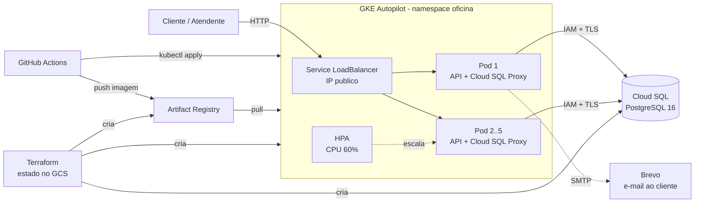
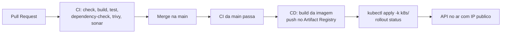

# Oficina Mecanica API

MVP do back-end de um Sistema Integrado de Atendimento e Execucao de Servicos,
modelado com Domain-Driven Design (DDD) em monolito em camadas.

## Motivacao

Uma oficina mecanica de medio porte, especializada em manutencao de veiculos,
tem enfrentado desafios para expandir seus servicos com qualidade e eficiencia.
Atualmente, o processo de atendimento, diagnostico, execucao de servicos e
entrega dos veiculos e feito de forma desorganizada, utilizando anotacoes manuais
e planilhas, o que gera problemas como:

- Erros na priorizacao dos atendimentos;
- Falhas no controle de pecas e insumos;
- Dificuldade em acompanhar o status dos servicos;
- Perda de historico de clientes e veiculos;
- Ineficiencia no fluxo de orcamentos e autorizacoes.

Diante disso, a oficina decidiu investir no sistema, que permitira aos clientes
acompanhar em tempo real o andamento do servico, autorizar reparos adicionais via
aplicativo e garantir uma gestao interna eficiente e segura.

## Objetivos da Fase 2

A Fase 1 entregou o dominio (clientes, veiculos, materiais, servicos, ordem de
servico) e as APIs core. A Fase 2 evolui a solucao para produzir:

- Listagem de ordens de servico ordenada por status e idade, excluindo as
  finalizadas e entregues;
- Abertura de OS ja com servicos e pecas em uma unica chamada;
- Observabilidade via Spring Boot Actuator (liveness/readiness);
- Job de expiracao de orcamento coordenado entre replicas com ShedLock;
- Notificacao por e-mail ao cliente a cada mudanca de status (Brevo);
- Deploy em Kubernetes (GKE Autopilot) com infraestrutura provisionada por
  Terraform, pipeline de CI/CD e escalabilidade automatica validada por teste
  de carga.

## Stack

- Java 21, Spring Boot 3.5.x (Web, Data JPA, Security, Validation, Actuator)
- PostgreSQL 16 (schema via Flyway, `ddl-auto=validate`)
- JWT para autenticacao das APIs administrativas
- springdoc-openapi (Swagger), MapStruct (mapeamento entre camadas)
- JUnit 5, Mockito, REST-assured e Testcontainers (Postgres real)
- Docker / docker-compose

## Arquitetura

Fluxo: Controller → UseCase → Domain + Repository (porta) → Impl JPA.

```
com.postech.oficinamecanica
├── domain            # entidades, agregados, regras de negocio (sem Spring/JPA)
├── application       # casos de uso + interfaces de repositorio
├── infrastructure    # persistencia JPA, seguranca (JWT), configuracoes
└── interfaces        # controllers REST e DTOs (record)
```

Entidades de dominio: `Customer`, `Vehicle`, `Material`, `Service`, `Employee` e
o agregado central `ServiceOrder` (com `ServiceOrderHistory`) + `MaterialTransaction`.

## Como rodar

Pre-requisitos: Docker, Docker Compose, **Java 21** e **Maven do sistema**
(o repo NAO tem wrapper `mvnw`).

```bash
docker compose up --build        # sobe app + Postgres
mvn spring-boot:run              # app sem Docker, sobe o banco via spring-boot-docker-compose
```

- API: `http://localhost:8080`
- Swagger UI: `http://localhost:8080/swagger-ui.html`
- Health (Actuator, publico): `/actuator/health`, `/actuator/health/liveness`, `/actuator/health/readiness`
- Postgres: `localhost:5432` (usuario/senha `oficina`/`oficina`, banco `oficina_mecanica`)

Notificacao por e-mail (mudanca de status da OS via Brevo): defina `BREVO_SMTP_USERNAME`,
`BREVO_SMTP_PASSWORD` (SMTP key da Brevo) e `MAIL_FROM` no ambiente. `BREVO_SMTP_HOST` e
`BREVO_SMTP_PORT` ja tem default (`smtp-relay.brevo.com` / `587`). Sem essas variaveis o
envio so' falha silenciosamente (logado), a ordem de servico continua funcionando normal.

## Testes

```bash
mvn test
```

- **Docker obrigatorio:** testes JPA/HTTP sobem Postgres 16 real via Testcontainers
  (`postgres:16-alpine`); sem Docker eles falham.
- Cobertura minima exigida: 80% em dominios criticos (JaCoCo em
  `../../target/site/jacoco/index.html`).
- Nome dos testes em ingles, padrao `should<Comportamento>When<Condicao>`.

## Testes locais via collection do Insomnia

Para exercitar a API de ponta a ponta (fluxo completo da Ordem de Servico) sem
escrever codigo, use a collection em [`../../docs/insomnia`](docs/insomnia/):

1. **Suba a API** (como acima): `docker compose up --build` ou `mvn spring-boot:run`.
   O Flyway cria o schema e semeia os dados iniciais.
2. **Importe a collection** no Insomnia: *Insomnia > Import > From File*,
   selecione `../../docs/insomnia/oficina-mecanica-api.insomnia.json`. O ambiente
   `Base Environment` ja aponta para `http://localhost:8080`.
3. **Logue** com o funcionario inicial (criado na migration
   `V6__seed_initial_employee.sql`):
   - `POST /auth/login`
   - Email: `carlos.souza@oficina.com`
   - Senha: `senha123`
   - Copie o `token` da resposta para a variavel de ambiente `token` — todas as
     requisicoes `/api/*` usam Bearer com essa variavel.
4. **Siga o roteiro** da collection: pre-requisitos (veiculo, servico) → fluxo da OS
   (abrir, diagnostico, itens, orcamento, aprovacao, conclusao, entrega) →
   acompanhamento do cliente (sem token) → cenarios de erro. Ajuste as variaveis
   `orderId`, `serviceId` e `materialId` conforme avancar.

Detalhes do roteiro, efeitos colaterais por etapa e codigos de erro em
[`../../docs/insomnia/README.md`](docs/insomnia/README.md).

## Endpoints principais

| Recurso | Base | Obs |
|---|---|---|
| Autenticacao | `POST /auth/login` | publica, gera JWT |
| Clientes | `/api/customers` | CRUD + `PATCH /{id}/status`, `GET /document` |
| Veiculos | `/api/vehicles` | CRUD + `PATCH /{id}/status`, `PATCH /{id}/owner` |
| Materiais | `/api/materials` | CRUD + `GET /low-stock`, `PATCH /{id}/status`, `POST /{id}/stock-entry` |
| Movimentacao de estoque | `/api/material-transactions`, `/api/materials/{id}/transactions` | entradas/saidas de estoque |
| Servicos | `/api/services` | CRUD + `PATCH /{id}/status` |
| Ordem de servico | `/api/service-orders` | abertura (com servicos e pecas opcionais), listagem por prioridade, diagnostico, servicos, materiais, orcamento, conclusao, cancelamento, entrega |
| Funcionarios | `/api/employees` | CRUD + `PATCH /{id}/status` |

## Collection das APIs

Colecao completa de requests (importavel no Insomnia), na branch `main`:
[github.com/Tech-Challenge-Pos-SOAT/oficina-mecanica-api/tree/main/docs/insomnia](https://github.com/Tech-Challenge-Pos-SOAT/oficina-mecanica-api/tree/main/docs/insomnia).
Com a aplicacao no ar, os mesmos endpoints tambem ficam documentados no Swagger
em `/swagger-ui.html`.

## Deploy no Google Cloud (Fase 2)

A versao final roda no GKE Autopilot com Cloud SQL, criada por Terraform.
Decisoes completas, diagramas e tabela de escolhas em
[`docs/arquitetura.md`](docs/arquitetura.md); passo a passo detalhado em
[`docs/deploy-gcp.md`](docs/deploy-gcp.md).





Imagem em alta resolucao: [`docs/img/arquitetura.png`](docs/img/arquitetura.png).

### Provisionamento com Terraform

Cria GKE Autopilot, Cloud SQL, Artifact Registry, IAM e Workload Identity
Federation (lista completa em [`infra/README.md`](infra/README.md)):

```bash
cd infra
./bootstrap.sh SEU_PROJECT_ID
cp terraform.tfvars.example terraform.tfvars
export TF_VAR_db_password='uma-senha-forte'
terraform init -backend-config="bucket=SEU_PROJECT_ID-tfstate"
terraform apply
```

### Deploy em Kubernetes

Os manifestos ficam em [`k8s/`](k8s/) (namespace, ServiceAccount, ConfigMap,
Secret, Deployment com sidecar Cloud SQL Auth Proxy, Service LoadBalancer, HPA
2-5 replicas, PDB). O CD (testes, build da imagem, push e
deploy) dispara em todo push na branch `deploy-google-cloud`, sem depender da
`main` (`git push origin SUA-BRANCH:deploy-google-cloud`); para validar pelo
Cloud Shell:

```bash
export DB_PASSWORD='a-mesma-senha-do-terraform'
export JWT_SECRET="$(openssl rand -base64 48)"
./scripts/deploy-gcp-manual.sh

gcloud container clusters get-credentials oficina-cluster --region us-central1
kubectl -n oficina get pods,hpa,svc
```

O IP publico muda a cada ambiente (o atual sera destruido apos a avaliacao);
obtenha o IP vigente com `kubectl -n oficina get svc oficina-api`.

### Resultado do teste de escalabilidade

Teste de carga com k6 ([`load-test/hpa-load.js`](load-test/hpa-load.js)), 150
usuarios virtuais simultaneos:

| Metrica | Resultado |
|---|---|
| Replicas | 2 → 5 (HPA, CPU alvo 60%) |
| Tempo para atingir 5 replicas | ~1 minuto |
| CPU no pico | 269% do alvo |
| Requisicoes com falha | 0% |
| Checks (k6) | 17.336 passando |

```bash
BASE_URL=http://IP_EXTERNO k6 run load-test/hpa-load.js   # -e PEAK_VUS / -e P95_MS ajustam carga e threshold
kubectl -n oficina get hpa -w
```

### Video demonstrativo

[SEU_LINK_DO_VIDEO_AQUI](SEU_LINK_DO_VIDEO_AQUI) — deploy, execucao do CI/CD,
consumo das APIs e escalabilidade automatica (roteiro em
[`docs/roteiro-video.md`](docs/roteiro-video.md)).

## Pipeline de CI (`../../.github/workflows/ci.yml`)

Sequencial em todo PR/push para `main`: **check** (branch atualizada) → **build**
→ **test** (+ JaCoCo) → **dependency-check** (OWASP/NVD) → **trivy** (imagem) →
**sonar**. Relatorios de vulnerabilidade ficam como artifacts do workflow.

Dependency-Check roda fora do ciclo Maven, de proposito; local:

```bash
mvn org.owasp:dependency-check-maven:12.2.2:check -DnvdApiKey=SEU_TOKEN
```

SonarQube: Community Edition local, job roda em runner self-hosted
(`http://sonarqube.local:9000`). Mais detalhes em `../../docs/sonarqube-local.md`.

## Arquitetura DDD e convencoes

Codigo, identificadores e commits em ingles; docs e conversa em portugues.
Nomes de dominio saem de `../../docs/contexts/modelo-de-dados.md`.

- Banco: schema so via Flyway; **mudou entidade JPA → nova migration `V<N>__desc.sql`**,
  nunca editar migration ja aplicada.
- Mapeamento entre camadas via MapStruct (`@Mapper(componentModel="spring",
  unmappedTargetPolicy=ReportingPolicy.ERROR)`); DTOs sao `record`.
- Dominio sem dependencia de framework; mocks so em portas (repository), nunca em domain.

## Documentacao

- Indice "tarefa → doc": [`../../docs/contexts/context-index.md`](docs/contexts/context-index.md)
- Modelo de dados: [`../../docs/contexts/modelo-de-dados.md`](docs/contexts/modelo-de-dados.md)
- Testes automatizados: [`../../docs/contexts/testes-automatizados.md`](docs/contexts/testes-automatizados.md)
- SonarQube local: [`../../docs/sonarqube-local.md`](docs/sonarqube-local.md)
- Requests (Insomnia): [`../../docs/insomnia`](docs/insomnia/README.md)

## Grupo

- Willian (Bacelar): rm375919
- Alyson (Guimaraes): rm375812
- Joao (Araujo): rm376123
- Beatriz: rm376242
- Kawan: rm376144
