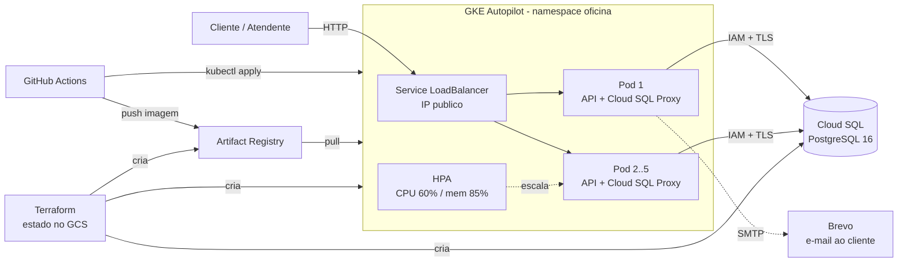
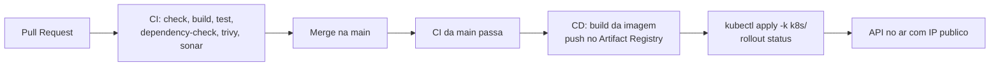

# Arquitetura da solucao (Fase 2)

## Visao geral

A API da oficina mecanica (Spring Boot 3.5, Java 21, Clean Architecture/DDD)
roda como um Deployment no GKE Autopilot. O trafego externo chega por um
Service do tipo LoadBalancer, que cria um IP publico no Google Cloud. Cada Pod
tem dois containers: a API e o Cloud SQL Auth Proxy, que abre uma conexao
autenticada por IAM com o Cloud SQL (PostgreSQL 16) e a expoe em
`127.0.0.1:5432` para a API. O HPA aumenta de 2 para ate 5 replicas conforme a
CPU e a memoria. As imagens ficam no Artifact Registry e o pipeline do GitHub Actions entrega
tudo sem nenhuma chave JSON, usando Workload Identity Federation.

## Fluxo de entrega

## Decisoes

| Decisao | Escolha | Motivo |
|---|---|---|
| Kubernetes | GKE Autopilot | Sem gerenciar nos; metrics-server e Workload Identity ja vem ativos; cobra por Pod |
| Banco | Cloud SQL (PostgreSQL 16) | Gerenciado, com backup; evita rodar estado dentro do cluster |
| Acesso ao banco | Cloud SQL Auth Proxy como sidecar | Autenticacao por IAM, sem rede autorizada e sem senha em rota publica aberta |
| Exposicao externa | Service LoadBalancer | IP publico sem precisar de dominio nem certificado |
| Escala | HPA por CPU e memoria (2 a 5 replicas) | Requisito do desafio; requests de CPU e memoria definidos no Deployment |
| Job diario de expiracao | ShedLock no proprio Postgres | Com varias replicas, apenas uma executa por rodada |
| Segredos | Secret do Kubernetes criado pelo pipeline a partir de GitHub Secrets | Nada sensivel versionado no repositorio |
| Identidade do pipeline | Workload Identity Federation | Sem chave JSON; so este repositorio consegue assumir a identidade |
| Infra como codigo | Terraform com estado remoto no GCS | Reproduzivel e destrutivel com um comando |
| Observabilidade de saude | Actuator: liveness e readiness | Probes do Kubernetes; readiness inclui o banco |
